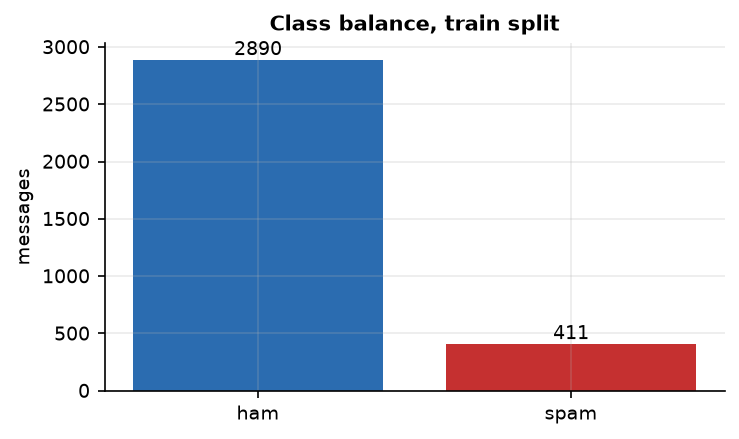
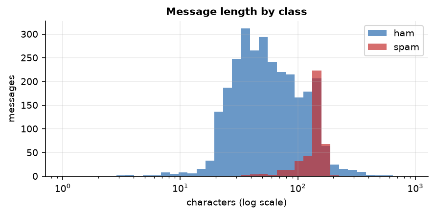
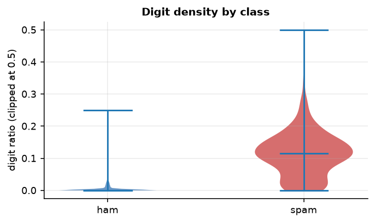
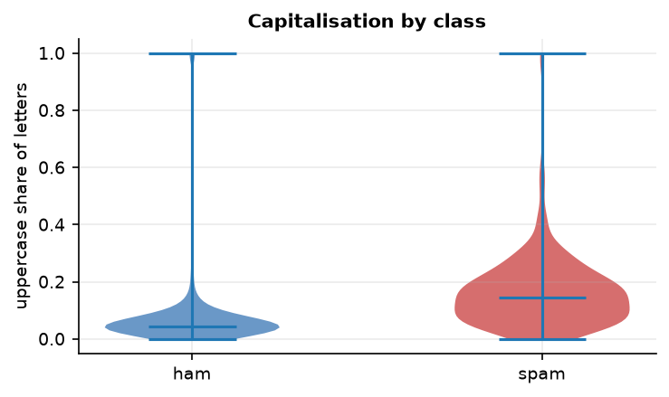
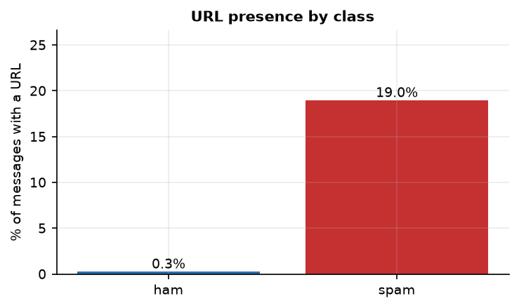
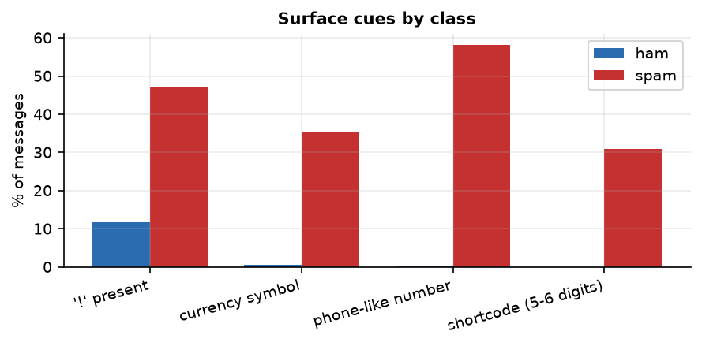
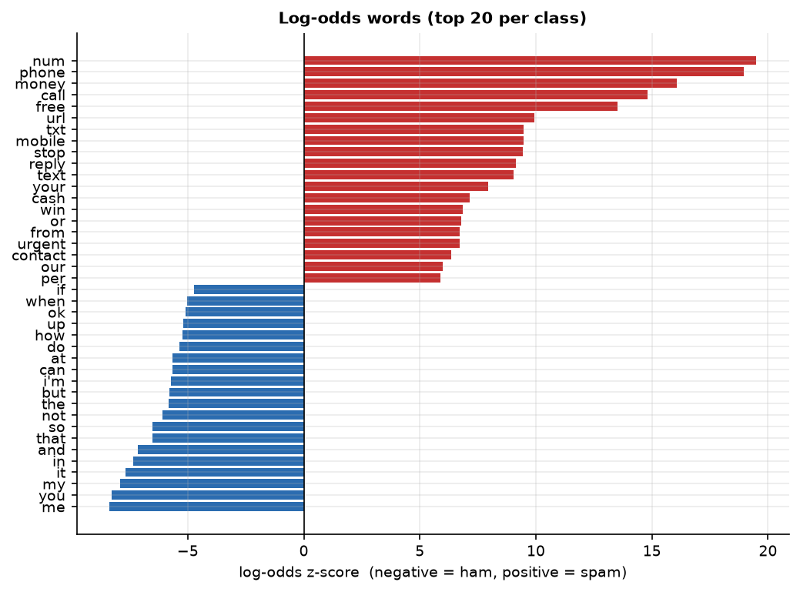
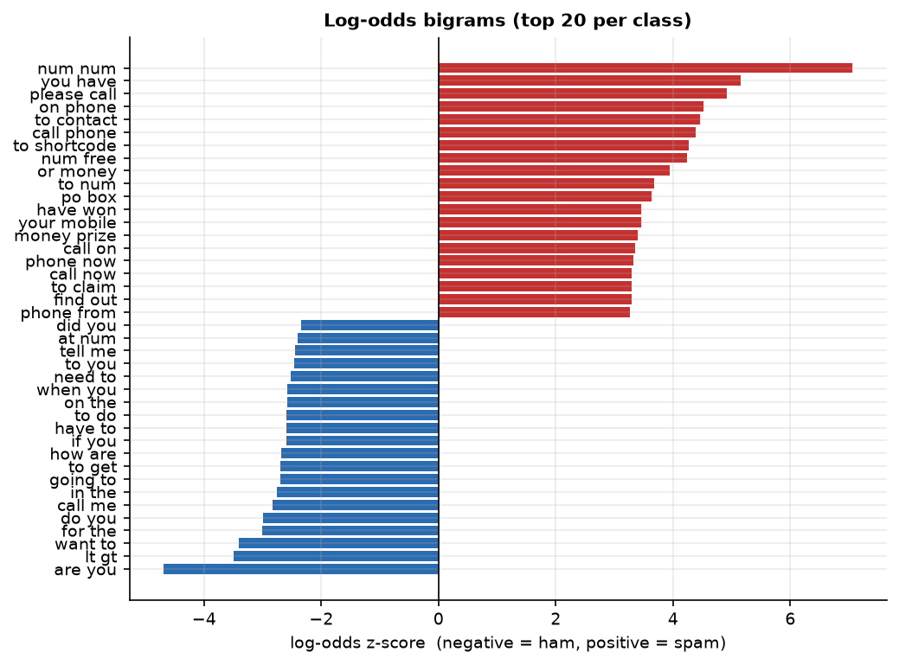

# EDA — UCI anchor (train split only)

Source: `data/processed/uci/train.csv` — 3,301 rows (411 spam / 2,890 ham, 0.125 spam).
The cal and test splits are not plotted. Every figure is regenerated by `python -m smishlens.eda`.

## 1. Class balance

Insight: only 12.5% of training messages are spam, so accuracy is uninformative and every model is scored on PR-AUC / recall at a fixed FPR.

## 2. Message length

Insight: spam is longer at the median (148 vs 53 chars), but the distributions overlap heavily — length alone separates little.

## 3. Digit density

Insight: spam carries more digits (median 0.115 vs 0.000) — prices, shortcodes and phone numbers. The overlap means it is a supporting feature, not a rule.

## 4. Capitalisation

Insight: spam shouts more (median caps ratio 0.146 vs 0.045), but many spam rows are lower-case, so casing is a weak prior rather than a reliable cue.

## 5. URL presence

Insight: URLs are rare in both classes (0.3% of ham, 19.0% of spam). The anchor cannot support strong claims about link-based detection; that experiment belongs to the modern pool.

## 6. Surface cues

Insight: currency symbols and shortcodes are almost exclusive to spam (35.3% vs 0.5% for currency; 30.9% vs 0.0% for shortcodes), while '!' is much more common in spam (47.0% vs 11.7%) yet still appears in roughly one ham message in eight, so it is a weak cue on its own.

## 7. Log-odds words

Insight: the spam side is dominated by offer mechanics (free, call, money, phone, num); the ham side by conversational fillers (me, you, my, it, in). These are corpus-era cues, not stable smishing signals — a reason to validate on the modern pool.

## 8. Log-odds bigrams

Insight: bigrams expose campaign templates on the spam side (on phone, please call, you have, num num) and social phrasing on the ham side (are you, lt gt, want to, for the); the `lt gt` term is an unescaped HTML-entity artefact in the corpus, not language. This is why word 1-2 grams are in the production feature set.
